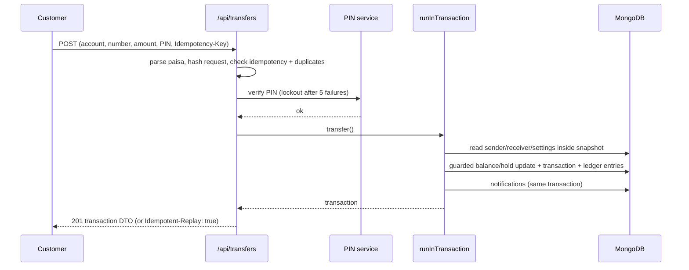

# Bhorsa — digital banking management system

Bhorsa (ভরসা, "trust") is a **simulated** digital bank. It is a production-quality web app that models customers, staff and admins, accounts, transfers, deposit/withdrawal requests, loans, statements and analytics — without touching real money, cards or payment gateways. **No real money moves in this app.**

Live URL: _add your deployment URL here._

## What is included

### Customers
- Register and sign in, with a server-verified session.
- Multiple savings, current and business accounts with balances, holds and limits.
- Instant transfers to other customers and between their own accounts, protected by a transaction PIN and a review step for large or risky transfers.
- Deposit and withdrawal requests; withdrawals place a hold that blocks spending until approved.
- Apply for loans with a live EMI preview, view the repayment schedule and pay installments or pay off early.
- Statements (CSV/PDF), PDF receipts, notifications, dark mode and a responsive layout from 360px upward.

### Staff
- Register customers and review their KYC details.
- Open accounts for verified customers.
- Work queues for pending requests, held transfers, open flags and loans.
- Approve or reject requests and held transfers up to a configurable approval limit; flag transactions; add loan notes and forward loans to admins.
- Search customers and transactions; view bank settings read-only.

### Admins
- Everything staff can do, plus edit bank-wide settings, create staff users, freeze accounts, set limits, manage customer status and blocks, resolve flags, reverse transfers and decide on loans (approve/reject/disburse).
- Live analytics dashboards, an integrity check and an append-only audit log.

## Roles and permissions

Authorization is enforced on the server in every route and service (`src/server/auth/guards.ts`, `withHandler` in `src/server/http/handler.ts`). The UI only hides controls; it is never the sole gate. A customer requesting a resource they do not own receives **404** so its existence is not revealed.

| Action | Customer | Staff | Admin |
|---|---|---|---|
| View own accounts, transactions, requests, loans | ✓ (own only) | — | — |
| Register customers, verify KYC | — | ✓ | ✓ |
| Open accounts for KYC-verified customers | — | ✓ | ✓ |
| Update account info, freeze/unfreeze, set limits | — | — | ✓ |
| Activate/deactivate or block customers | — | — | ✓ |
| Transfer, request deposit/withdrawal, apply/repay loan | ✓ | — | — |
| Approve/reject deposit or withdrawal requests | — | ✓ (up to limit) | ✓ |
| Approve/reject held transfers | — | ✓ (up to limit) | ✓ |
| Flag a transaction | — | ✓ | ✓ |
| Resolve flags, reverse transfers | — | — | ✓ |
| Add loan notes, forward loans | — | ✓ | ✓ |
| Approve, reject, disburse loans | — | — | ✓ |
| Edit settings, create staff, view audit log | — | — | ✓ |

Nobody can approve, reject, review or disburse anything they initiated (`SELF_APPROVAL_NOT_ALLOWED`).

## Architecture

Next.js 16 App Router, React 19, TypeScript strict, HeroUI v3, Tailwind CSS 4, Better Auth with a MongoDB adapter, Mongoose for app data, Redux Toolkit + RTK Query on the client, Recharts for charts, Zod 4 for validation and Vitest for tests.

```
Browser → RTK Query hooks → /api/* route (withHandler)
        → service (guards + transaction) → MongoDB
Server components → role layouts → StoreProvider → AppShell
```

### Redux Toolkit and RTK Query
- Store (`src/store/store.ts`): reducers `api`, `auth`, `ui`, `accounts`, `transactions`, `loans`; middleware `baseApi.middleware`, `errorMiddleware`, `listenerMiddleware`.
- `baseApi` (`src/store/baseApi.ts`) wraps `fetchBaseQuery` and normalizes every error to `ApiError { status, code, message, fieldErrors?, details? }`.
- Tag types: `Me, Account, Transaction, Request, Loan, Notification, Customer, Stats, Settings, AuditLog`.
- Each feature (`src/features/<domain>/api.ts`) injects endpoints with `providesTags` (item IDs plus `LIST`) and precise `invalidatesTags` — e.g. a transfer invalidates `Account`, `Transaction`, `Stats` and `Notification`.
- Server data stays in RTK Query's cache; feature slices hold only client state (selected account, filters, EMI preview). `signedOut` resets the whole store and clears the API cache.
- `ui.pendingRequests` drives a delayed global progress bar; `errorMiddleware` handles 401 (sign out + redirect), 403 (toast) and 5xx (toast). Forms handle 409/422 inline.

### Authentication
Better Auth (`src/server/auth/auth.ts`) with email/password, the admin plugin (`ac`/`roles` in `src/lib/permissions.ts`), database rate limiting, 12-hour sessions and `nextCookies()` last. The MongoDB adapter uses the shared native `MongoClient` with transaction support. `src/proxy.ts` performs optimistic redirects only; each role layout checks the session on the server and every API route re-checks roles. A `hooks.before` middleware blocks privilege escalation, including setting `role` at sign-up. An after-create hook provisions a `CustomerProfile` for new customers. Blocking uses the admin plugin's ban API.

### Transaction processing
Money is stored as integer **paisa** in fields ending in `Minor` (`toMinor`/`formatBDT` in `src/lib/money.ts`). Every movement is one MongoDB transaction with balanced, append-only ledger entries:

| Operation | Debit | Credit |
|---|---|---|
| Transfer (A, fee F) | sender A+F | receiver A; FEE_INCOME F |
| Deposit approved | CASH_CLEARING A | customer A |
| Withdrawal approved | customer A | CASH_CLEARING A |
| Loan disbursed | LOAN_PORTFOLIO A | customer A |
| Loan repayment | customer A | LOAN_PORTFOLIO A |
| Reversal | receiver A; FEE_INCOME F | sender A+F |



Holds reserve money without moving it (`available = balance − hold`). Every spending check keeps `minimumBalanceMinor` intact. Idempotency keys are unique per user; a same-key/same-payload retry replays the result, a different payload returns 409. Concurrent transfers are safe because reads and guarded writes happen inside one snapshot transaction; write conflicts are retried by the driver. `npm run verify:ledger` checks all five invariants from build prompt §6.4.

### Database structure

Better Auth owns `user`, `session`, `account`, `verification`, `rateLimit`. App collections (Mongoose):

| Collection | Key fields | Purpose |
|---|---|---|
| `customerprofiles` | userId, kycStatus, status, pin (hashed, `select: false`) | KYC, profile, PIN lockout |
| `bankaccounts` | accountNumber, kind, ownerId, type, balanceMinor, holdMinor, limits, dailyOutflow | Customer and system accounts |
| `transactions` | reference, type, status, amountMinor, accounts, flags, review, reversal | Every money movement |
| `ledgerentries` | transactionId, accountId, direction, amountMinor, balanceAfterMinor | Append-only double entry |
| `depositwithdrawalrequests` | kind, accountId, status, holdMinor | Request workflow |
| `loans` | applicantId, principalMinor, status, schedule, repayments, notes | Loans and EMI schedules |
| `notifications` | userId, type, readAt | Notification center |
| `auditlogs` | actorId, action, entityType, before/after | Append-only audit trail |
| `banksettings` | key: "default", limits, fees, loan products, risk | Bank-wide configuration |
| `counters` | `_id: "accountNumber"`, seq | Atomic account-number sequencing |
| `ratelimits` | key, count, expiresAt (TTL) | Database-backed rate limits |

`ledgerentries`, `auditlogs`, `counters`, `banksettings`, `ratelimits` and the three system accounts (`CASH_CLEARING`, `LOAN_PORTFOLIO`, `FEE_INCOME`) exist to keep financial data consistent, auditable and safe; they are not surfaced to customers.

### Security implementation
- Server-side balance/limit validation and conditional updates; amounts are parsed from decimal strings into integer paisa.
- One MongoDB transaction per money movement with balanced ledger entries.
- Ownership checked on every customer request; cross-customer access returns 404.
- Transaction PIN: scrypt + random salt, constant-time comparison, 15-minute lockout after 5 failures.
- `Idempotency-Key` required on money-moving POSTs with a unique index and a soft duplicate check.
- Rate limits in MongoDB (`ratelimits` TTL collection) per user per action.
- Origin check on all mutating routes (`assertAllowedOrigin`).
- Security headers in `next.config.ts`: `X-Frame-Options`, `X-Content-Type-Options`, `Referrer-Policy`, `Permissions-Policy`, CSP and HSTS in production. CSP uses `'unsafe-inline'` for scripts/styles because the Next.js App Router injects inline bootstrap and HeroUI/Tailwind rely on inline styles; fonts are self-hosted by `next/font`.
- No passwords, PINs or session tokens are ever logged.

### Design system
"Petrol, Mist, Lime": petrol `#0B5563` (brand surfaces), mist `#F2F5F4` (canvas), lime `#C8F169` (the single primary action per view). All colors live in `src/styles/theme.css` as CSS variables; no hex colors elsewhere. Display type is Newsreader, UI is IBM Plex Sans with Noto Sans Bengali as the ৳ fallback. Status badges pair an icon with a text label, so color is never the only signal. Recharts series use fixed `--chart-1…5` tokens with a table view on every chart card.

## Local setup

1. Create a MongoDB Atlas cluster (a replica set is required for transactions). Allow network access from `0.0.0.0/0` for this demo only.
2. Copy `.env.example` to `.env.local` and fill in `MONGODB_URI`, `BETTER_AUTH_SECRET` (`openssl rand -base64 32`) and the URLs.
3. `npm install` (already present in this workspace).
4. `npm run ensure-indexes` then `npm run seed` with `SEED_ALLOW_RESET=true` to load deterministic demo data.
5. `npm run dev` and open http://localhost:3000.

### Demo credentials

| Role | Email | Password |
|---|---|---|
| Admin | `admin@bhorsa.demo` | `Admin@1234` |
| Staff | `staff@bhorsa.demo` | `Staff@1234` |
| Customer | `customer@bhorsa.demo` | `Customer@1234` |

The demo customer's transaction PIN is `1234`. Other seeded customers use `Customer@1234` and the same PIN.

### Scripts
- `npm run dev` — development server
- `npm run build` / `npm run start` — production build and server
- `npm run lint` — ESLint
- `npm run typecheck` — TypeScript
- `npm run test` — Vitest against an in-memory replica set
- `npm run seed` — reset and load demo data (requires `SEED_ALLOW_RESET=true`)
- `npm run ensure-indexes` — create MongoDB indexes
- `npm run verify:ledger` — check the five ledger invariants

## Deployment (Vercel)
1. Create a free MongoDB Atlas cluster and allow access from `0.0.0.0/0` (acceptable for this demo).
2. Import the GitHub repo into Vercel and set every variable from `.env.example`. Set `BETTER_AUTH_URL` and `NEXT_PUBLIC_APP_URL` to the production URL.
3. Deploy, then seed from a local machine using the production `MONGODB_URI` and `SEED_ALLOW_RESET=true`, and run `npm run verify:ledger`.

## Note
Bhorsa is a simulated bank for demonstration. No real money, cards or payment gateways are involved.
